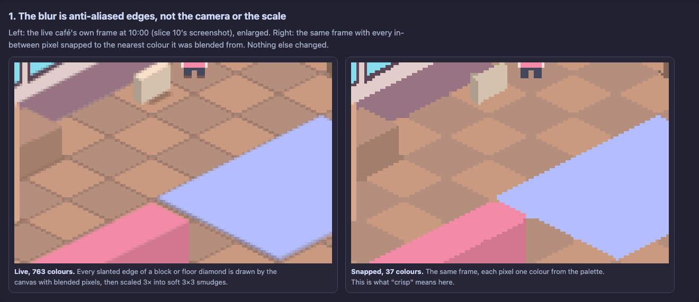
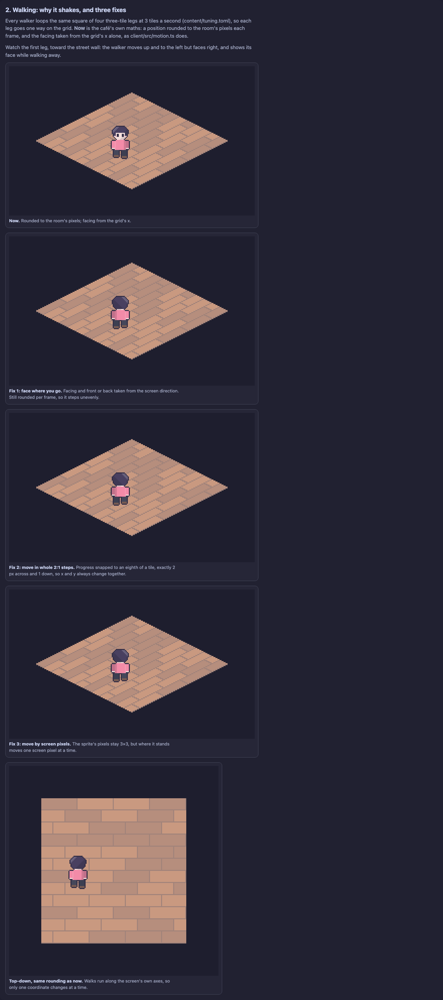
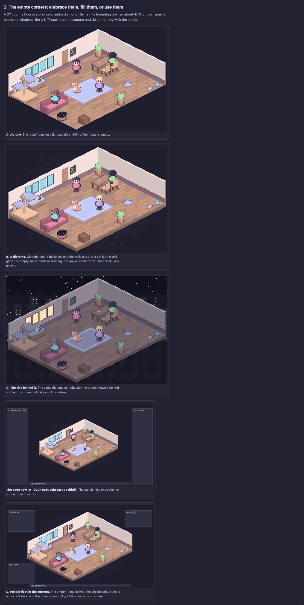
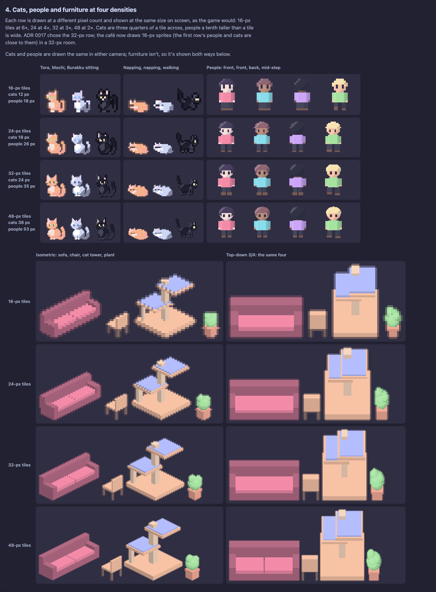
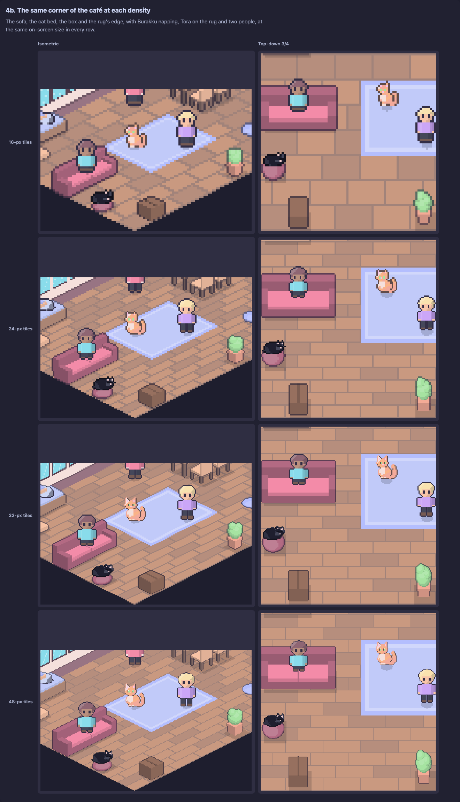
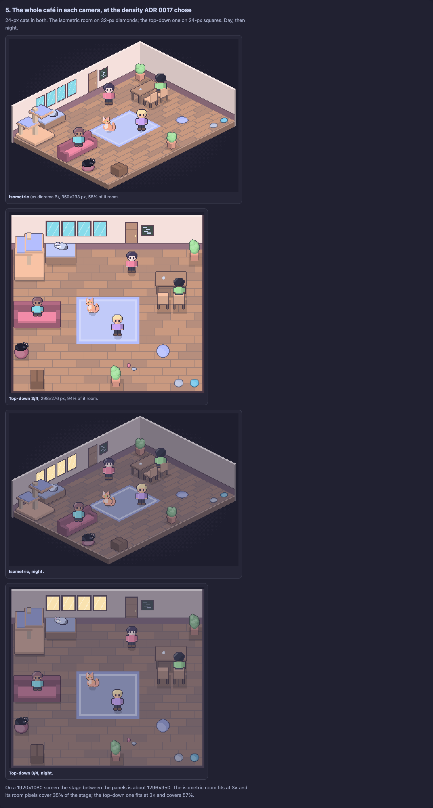

# The look, reconsidered: blur, walking, corners, density and the camera

**Status:** a judgement for the user, asked 2026-11-04 16:01 AEDT, five days
before the final submission. Nothing is decided here.
[ADR 0017](../adr/0017-draw-the-cafe-isometric-in-catppuccin-led-colours.md)
stands until the user chooses, and slice 11 waits on it.

The user, having lived with slices 09 and 10 (the isometric room in
Catppuccin colours, still with plain blocks and the old 16-px sprites),
asked:

1. The room looks blurred. Will it still, once every sprite is redrawn?
2. Cats and people seem to shake when they walk, maybe from following the
   old axes. Is that fixable?
3. The isometric view leaves empty corners. Is there a way round that?
4. What do cats, people and furniture look like at different densities?
5. Is a top-down 3/4 camera, like Stardew Valley's, a better fit, or does
   isometric win? Isometric was meant to give a modern lofi or cyber-café
   feel, and it may not be working out.

Every picture below was drawn by the throwaway study in
[screens/art-style/scripts/](screens/art-style/scripts/), from the café's
own layout (`content/room.toml`) and colours
(`content/sprites/palettes.json`). It models each piece once as simple
shapes and draws it pixel by pixel through either camera, so only the
camera and the pixel count change between pictures. These are studies,
not art: drawn sprites would have more character than these shapes. Run
`node docs/notes/screens/art-style/scripts/render.mjs` to draw them again;
open [`view.html`](screens/art-style/view.html) to see the walks move.

## 1. The blur is anti-aliasing, and it's in the code, not the camera

The scaling is clean. `fitScale` (`client/src/scale.ts`) only takes whole
numbers, and `#room` is `image-rendering: pixelated`. In slice 10's 3×
screenshot at 18:00, 12 of 77,952 3×3 blocks are mixed, so each room pixel
becomes a sharp 3×3 square.

The blur comes from what's drawn into the canvas. `render.ts` draws the
floor, walls and every block as filled polygons (`poly`), and a canvas
anti-aliases every polygon edge. `imageSmoothingEnabled = false` affects
only scaled images, not shapes. A single two-colour diamond drawn that way
comes out in 4 colours. The 10:00 frame, read one pixel per room pixel,
has 763 colours, where 37 fill everything that isn't an edge: every
slanted edge in the room is a soft band, and 3× scaling turns each soft
pixel into a soft 3×3 smudge.

**Will redrawn sprites fix it?** For the sprites, yes: PNGs blitted with
`drawImage` at whole pixel positions stay crisp, as the cats and people do
now. But the room (floor diamonds, walls and their window panes) is drawn
as polygons too, and slice 11 as written replaces sprites, not the room.
So **the floor and walls would stay blurred** unless they are drawn as
tiles too, or filled pixel by pixel. That fix is small and works in either
camera: draw the floor and walls from tile images, or fill shapes with no
anti-aliasing (the right-hand picture above).

## 2. The shaking is three separate things, and all three can be fixed

*(A still. [`view.html`](screens/art-style/view.html) loops all five at
once.)*

- **Walkers face the wrong way.** `client/src/motion.ts` sets `facing`
  from the grid's x alone, and the sprites have only a front view. Seen
  from the front-right corner, a step toward the street wall (y − 1) goes
  up and to the left on screen, while the sprite still faces right and
  shows its face. A step along x goes up and to the right, or down and to
  the left. Walkers moonwalk on two of the four directions and always show
  their faces. This is the most visible part of the "shake".
- **Steps are uneven.** A position is rounded to the room's pixels each
  frame (`render.ts`, `feetAt` and `blit`). A 2:1 diagonal at 3 tiles a
  second, at 60 frames a second, steps (1,0), (1,1), (0,0), (1,1),
  (1,0)... room pixels: over a second, 23 sideways steps, 24 diagonal ones
  and 12 frames where the walker doesn't move. At 3× each is a 3-px jump
  on screen, in an uneven rhythm. A top-down walk moves one axis at a
  time, so its steps are even.
- **The camera wobbles in layout B.** The follow-camera pans in whole
  screen pixels while the sprite moves in whole room pixels (3 screen
  pixels), so on a phone the walker wobbles ±1 px round the centre.

Fixes, smallest first:

1. **Face where you go:** take the facing from the screen direction, and
   give people and cats a back view, so a walk away shows the back. A few
   lines in `motion.ts` and `render.ts`, plus one more frame per sprite.
2. **Move in whole 2:1 steps:** snap progress so x and y always change
   together (2 px across, 1 down). Even, but steppier.
3. **Move by screen pixels:** keep the sprite's pixels 3×3 but place it at
   the screen's resolution. The smoothest; it costs "every pixel on the
   grid", and the camera would follow the same way.

The server's paths are four-way (`server/src/room.rs`, `path`) and that's
fine. Diagonal paths would make walks shorter, not smoother.

## 3. The corners: the shape is fixed, but the space can be used

A 2:1 room's floor is a diamond, and a diamond fills half its bounding
box. As now, 43% of the room's frame is empty: 40% in slice 10's
screenshot, which counts its exact backdrop colour. No art changes that,
so the choice is what to put there:

- **B, a diorama.** Give the floor a thickness and the walls a top, and
  set it on a soft glow. The empty space then reads as framing, the way
  isometric "lofi room" art is usually shown. Cheap.
- **C, the street behind it.** Sky and the towers' lit windows fill the
  top corners: a reason for the space, and the café's clock made visible.
  At night it's the closest of these studies, to my eye, to the user's
  "cyber café".
- **D, panels float in the corners.** The chalkboard, the cats and who's
  here sit in the empty triangles instead of in columns. The room then
  grows from 3× to 4× at 1920×1080, 78% more room on screen. This changes
  the page and the phone layout, so it's the most work of the four.

## 4. Density

Each row is drawn at a different pixel count, shown at the same size on
screen. Cats are three quarters of a tile, people a tenth taller.

- **16-px tiles (12-px cats):** silhouettes. The three cats are told apart
  by coat only, and faces are a pixel or two.
- **24-px tiles (18-px cats):** faces and ears read; the cats start to
  differ by shape, Mochi round, Burakku slim with tall ears, Tora striped.
- **32-px tiles (24-px cats), ADR 0017's choice:** faces, chests and
  stripes all read, and furniture gets its details (the sofa's two
  cushions, the tower's platforms and post).
- **48-px tiles (36-px cats):** nicer still, but each frame is over twice
  the drawing of 32, and the room is 504 px wide at 1×, wider than a
  phone.

The same corner of the café at each density, in both cameras. 32 is still
where I'd stop; this study doesn't change that part of ADR 0017.

## 5. The camera: top-down 3/4 or isometric

Both at the density ADR 0017 chose, with the same objects and colours.

| | Isometric (now) | Top-down 3/4 |
| --- | --- | --- |
| Feel | Depth and a corner, a room you look into; the lofi diorama look | Flat and cosy, like Stardew; the street wall faces you, square on |
| Room on a 1920×1080 stage | 3×, 35% of the stage | 3×, 57% of the stage |
| Empty frame | 42% (as diorama B) | 6% |
| Walking | Diagonal on screen: needs fixes 1 and 2 or 3, and back views | Along the screen's axes: rounding is even; needs back and side views |
| Blur | Needs the floor and walls drawn crisp | The same fix |
| Art to draw | Furniture in one isometric view each, standing and knocked over | Furniture front-on, simpler to draw and read |
| Hidden things | A tall piece hides what's behind it on a diagonal | A tall piece hides what's above it on screen, which I'd guess is easier to predict |
| What it costs now | Built, reviewed and live (slice 09) | A new camera, picking and checks: slice 09 again, a few days by my estimate |

My read, for the user to judge:

- **The blur and the shake aren't reasons to leave isometric.** Both come
  from fixable choices in the code (polygons drawn with anti-aliasing, and
  facing taken from the grid), and the blur would follow us into top-down.
- **Isometric is still the camera for the lofi or cyber-café feel.** The
  isometric studies above, crisp and with drawn furniture, are much closer
  to that than the live room is today, because the live room is plain
  blocks with a soft edge. The top-down room reads warmer and more like a
  cosy farm-game interior, and uses the screen far better, but it is the
  "normal" look the user wanted to leave on 17 October.
- **The real cost is time.** Five days out, switching camera spends most
  of them rebuilding slice 09, and leaves less for the art, which is what
  makes either camera look good. Staying isometric means: crisp floor and
  walls, facing and back views, even steps, a diorama or street backdrop,
  then slice 11's art. That's smaller than a camera change, and every step
  ships on its own.

## Left for the user

- **Which camera:** stay isometric and fix what's wrong with it, or switch
  to top-down 3/4 (a new ADR superseding 0017's camera, and a new slice).
- **If isometric:** which corner treatment (B, C, D, or B now and C later),
  and which walk fix (2, even 2:1 steps, or 3, screen-pixel placement).
- **Density:** 32-px tiles with 24-px cats still stands unless the user
  wants otherwise.
