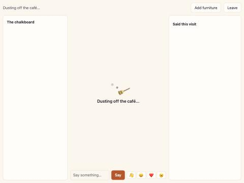

# Slice 07: getting in while the café wakes

[Slice 07](../slices/07-getting-in-while-the-cafe-wakes.md),
[plan](plan-slice-07-waking.md).

## On the image at Fly's baseline CPU

The judged line: "a first visitor after a long sleep gets the page at once
and the café within seconds". Checked 2026-10-15 on the image the deploy
builds, run with `docker run --cpus=0.0625` (a `shared-cpu-1x`'s guaranteed
share) and `/data` bind-mounted. The saved clock was set back three days
between a stop and a start, and the café was watched in the in-app browser.

- **The page answered 0.4 s after the start.**
- **Sign-up worked during the replay.** A new account's sign-up line came
  0.2 s before the wake-up line.
- **The replay of three days took 14.8 s** on the first try and 12.9 s on
  the second (`took_ms`; `"steps":259200,"capped":true`).
- **Waking, seen.** On the second try the browser reloaded during the
  replay. The café page opened at once, with "Dusting off the café…", the
  broom and the dust, the same words in the status line, and nothing of the
  café in the panels:

  

  When the replay ended the overlay went and the café opened, with three
  cats and "1/6 inside", without a reload.

So the line holds: the page is at once, the café about 13 to 15 seconds
later at the worst, and much sooner whenever the machine has CPU credit to
burst.

An empty board after three days asleep is right, not a fault. Everything
knockable fell in the first night and stayed down, and the lines from it
are over a day old by the end of the replay.

## Live (2026-10-15, with an agent account and Fly, as ADR 0015 allows)

Slice 07 went live with `d9e4adc` (CI green: the waking integration tests
in the Rust job, the browser checks and the log check in the other).

- **A cold start.** `flyctl machine stop` saved the café ("stopping: saving
  the café"). A minute later a request woke the machine: the page answered
  200 in 0.98 s, machine start included.
- **The order.** `listening` at 03:57:03.257, then the 60-second gap's
  `woke` line 3 ms later, as the log check now expects.
- **A visitor.** `agent_dde6f0` signed up and went straight in (welcome in
  139 ms, no `waking`): a replay of a minute is over before anyone can
  connect.

Seeing "Dusting off the café…" live would need the live save set back by
days. The image has no tool to edit it, and nothing untrusted was installed
to do so. So the image under `--cpus=0.0625` above is the evidence for the
long sleep, on the same binary and client.
