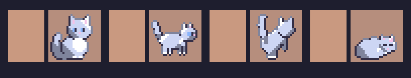

# Slice 11: where it stands

Session `a4e69a46`, 2026-11-05. The spec's settled order is one cat
first, judged by the user, then the rest in its style. This is that
first cat, drawn for judging and not yet in the café.

## Mochi at 24 px, every pose

- Drawn by `scripts/cats.mjs` (first written as `screens/slice-11/scripts/mochi.mjs`) from the shapes of the
  study's 24-px cats (`screens/art-style/scripts/study.html`, Mochi's
  round build, big white chest and short ears), in her coat's six palette
  slots, so the night colours and other coats still swap.
- 16 frames, 24×24, each also a grid in the café's text format
  (`screens/slice-11/mochi/mochi.txt`) and a PNG: sitting, walking (two
  steps), sitting and walking away (two steps), asleep, eating, playing
  (two frames), perched, held, on a lap, scratching, knocking something
  over, and greeting. Every frame faces right, as slice 12's review
  asked.
- Walking away is seen from behind: rump and raised tail nearest, the
  back of the head beyond, ears up, no face.

## What I'd want judged

- **Which poses read as what they're for.** By my eye: sitting, walking,
  walking away, asleep, eating, playing and knocking read; **held and
  perched look alike** (an upright cat), and **on a lap is close to
  asleep**. Those may need drawing again, or a prop (an arm, the seat's
  edge) the café draws round them.
- **The style:** the selective outline (softer on the lit top-left rim),
  the shading, and the size against a 32-px tile.
- **Whether Burakku and Tora should differ by shape as well as coat**:
  slim with tall ears and a long tail, and striped, as the study had.

Nothing else is drawn until this is judged: the other two cats, the
people at 32 to 36 px, and the furniture standing and knocked over. The
plan's part 2 ([plan-slice-11-art.md](plan-slice-11-art.md)) waits for
it, and the plan's pipeline (PNGs as the source of the text sheets, a
cat's build as data in `content/cats/`) is built once the style is
settled.

## Judged, 2026-11-05

The user, at 03:53 AEDT: "Mochi looks fine. continue that way." So part 2
goes ahead in her style: the pipeline, the café drawing 24-px cats with a
frame for each pose, Burakku and Tora, then the people and the furniture.
The poses I'd flagged (held and perched alike, on a lap close to asleep)
were passed as they are; they can be redrawn later as data.

## Part 2, tasks 1 to 3: in the café, 2026-11-05

- **The pipeline:** the cats are PNGs in `content/sprites/png/cat/<build>/`,
  drawn by `scripts/cats.mjs`; `scripts/sprites.ts` turns them into
  `content/sprites/cat.txt`, and a client test fails if the sheet isn't
  its output, or a PNG holds a colour that isn't one of the coat's slots.
- **A cat's build is data:** each file in `content/cats/` names its build
  (`round`, `slim`, `striped`) as it names its coat; the server checks it
  and sends it with the cat (`CatView.build`, regenerated by `cargo test`).
- **The café draws 24-px cats**, a frame per thing a cat does: walking (two
  steps, a back going away), sitting, asleep, on a lap, eating, playing
  (two frames), held, perched on the window seat, and a moment scratching,
  greeting or playing with someone when the café says so. A cat is picked
  where its 24-px sprite is drawn. Knocking over has a frame but nothing
  links it to a cat yet: the server's `furnitureToppled` doesn't say which
  cat did it.
- **Every frame faces right**, as the café mirrors a cat walking left
  (slice 12's review); a test holds it by each frame's eyes, or nose and
  ears, or head from behind, against its body's middle. Drawing the
  others showed that the study's sitting and sleeping cats faced left;
  they were turned.
- **Burakku and Tora** in Mochi's style: [slim](screens/slice-11/slim-sheet.png),
  [striped](screens/slice-11/striped-sheet.png).
- **For the user's judgement:** Tora's orange tabby coat and the floor's
  wood are both Catppuccin's peach, so by day he blends into the floor;
  his outline is what separates him. A deeper stripe matches the floor
  even more closely (measured). Changing his coat or the floor's wood is
  a palette call, not made here.

## Part 2, task 4: the people, 2026-11-05

- **People at 32 px**, about 31 tall, adult proportions: standing and two
  steps of a walk, front and back, drawn by `scripts/people.mjs` into
  `content/sprites/png/person/` in avatar 0's colours; `scripts/sprites.ts`
  writes `content/sprites/avatar.txt` from them, and a test holds it.
  Each visitor's skin, hair and shirt still swap by their look
  ([sheet](screens/slice-11/people-sheet.png)). The four looks share one
  shape; a different hairstyle per look would be a new field on a look,
  so an account and protocol change, not made.
- **Sized from the image:** a person stands, is mirrored and is picked at
  32 px; the "you" marker and emotes sit over the middle of the head; a
  bubble goes above a 30-px head; a carried piece rides over it.
- **What the bigger sprites changed in the checks:** a 32-px person covers
  the middle of the tiles just behind them, so a click there picks them,
  which is right; two checks that clicked the sofa's top behind someone,
  and a bare tile behind the test's own visitor, now aim where nobody
  stands.

## Part 2, task 4: the furniture, 2026-11-05

- **Each piece as its parts**, data in `content/sprites/furniture-models.json`:
  boxes within a kind's footprint, each from `z0` to `z1` and in its own
  furniture colour, listed in the order they're drawn (back to front,
  bottom to top: whoever draws a kind knows what's in front of what). A
  sofa has its back, arms and seat; the table and chairs stand on legs;
  the plant is a pot with leaves; the cat tower a base, a post, a low
  platform, a high one and a cubby; the cat bed a rim round a soft middle.
- **Crit 8's notes:** the window seat is a cushion on a board on legs, so
  the floor shows under it, not a shelf; the cushion is low and plump, not
  a box.
- **The same boxes cast the shadows** (slice 13): a raised part lets the
  light under it, and only parts on the floor darken it at their feet. A
  kind with no model, and any piece knocked over, stays the one block.
- A first try sorted the parts by a computed key, which a post through
  two platforms defeats; the cat tower came out a jumble. The model's own
  order fixed it.

## The princess hug, 2026-11-05

The user, at 10:13 AEDT, of the upright held cat: "no. use princess hugs
like these", with three pictures: a cartoon cat curled in a crook of
arms, and two people holding a cat cradled across their arms. Three
drawings of a cat on its back across the arms didn't read at 24 px
(a cat lying flat, then one standing on all fours); a curled cat, as the
cartoon has it, does. So the held frame is the nap's curl lifted to the
chest, eyes open, and the café draws the holder's arms round it in their
own skin: one under the cat rising toward its head, a hand on its back
(`drawHug` in render.ts). Their face shows above. A test holds the arms
across the cat in the holder's skin, and the cat below their eyes.
