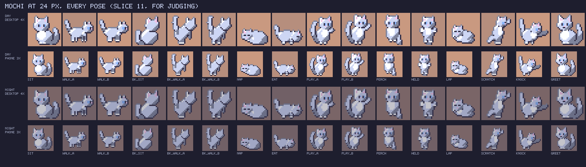

# Slice 11: where it stands

Session `a4e69a46`, 2026-11-05. The spec's settled order is one cat
first, judged by the user, then the rest in its style. This is that
first cat, drawn for judging and not yet in the café.

## Mochi at 24 px, every pose

- Drawn by `screens/slice-11/scripts/mochi.mjs` from the shapes of the
  study's 24-px cats (`screens/art-style/scripts/study.html`, Mochi's
  round build, big white chest and short ears), in her coat's six palette
  slots, so the night colours and other coats still swap.
- 16 frames, 24×24, each also a grid in the café's text format
  (`screens/slice-11/mochi/mochi.txt`) and a PNG: sitting, walking (two
  steps), sitting and walking away (two steps), asleep, eating, playing
  (two frames), perched, held, on a lap, scratching, knocking something
  over, and greeting. Every frame faces right, as slice 12's review
  asked.
- Walking away is seen from behind: rump and raised tail nearest, the
  back of the head beyond, ears up, no face.

## What I'd want judged

- **Which poses read as what they're for.** By my eye: sitting, walking,
  walking away, asleep, eating, playing and knocking read; **held and
  perched look alike** (an upright cat), and **on a lap is close to
  asleep**. Those may need drawing again, or a prop (an arm, the seat's
  edge) the café draws round them.
- **The style:** the selective outline (softer on the lit top-left rim),
  the shading, and the size against a 32-px tile.
- **Whether Burakku and Tora should differ by shape as well as coat**:
  slim with tall ears and a long tail, and striped, as the study had.

Nothing else is drawn until this is judged: the other two cats, the
people at 32 to 36 px, and the furniture standing and knocked over. The
plan's part 2 ([plan-slice-11-art.md](plan-slice-11-art.md)) waits for
it, and the plan's pipeline (PNGs as the source of the text sheets, a
cat's build as data in `content/cats/`) is built once the style is
settled.
