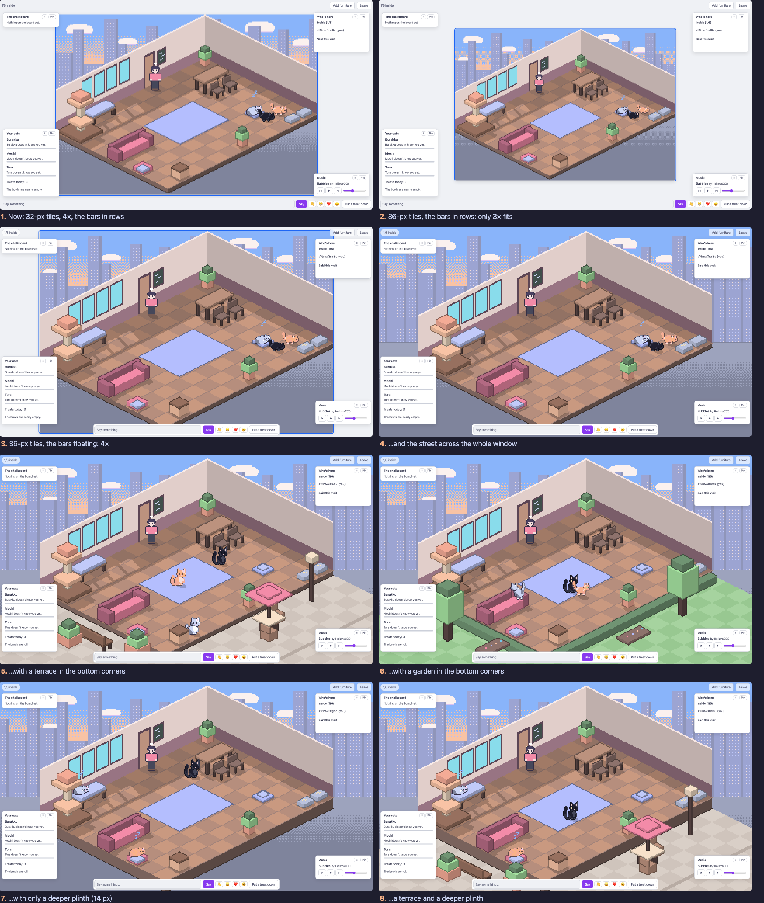
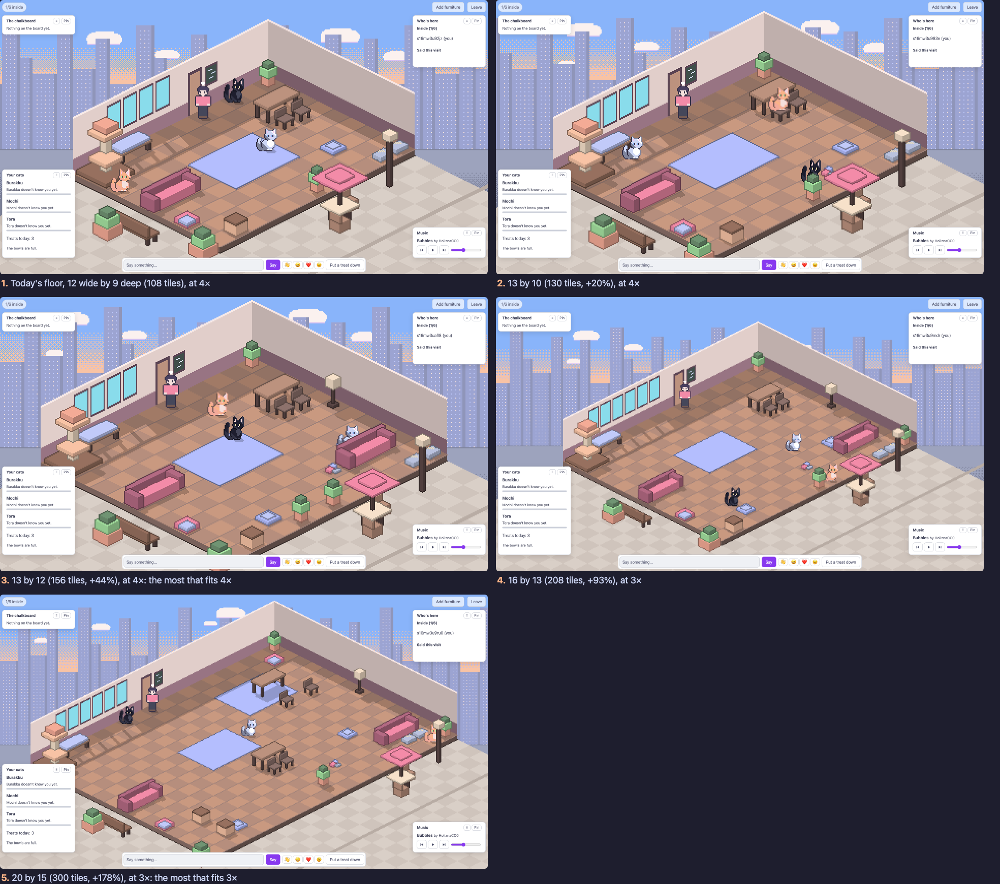

# Slice 16 study: a bigger room, its bottom corners, the street end to end

On 2026-11-06 the user sent a screenshot of the café at 1920×1080 (the
room at 4×, framed by the page's background on every side) and asked:

> 1. at 1080p the [Image #4] cafe won't fill whole page. instead of
>    changing the zoom, increase the tile size of the cafe
> 2. the bottom left and right corner of the cafe is empty, think about
>    ways we can improve that
> 3. let the background extend end to end to fill the whole page, even if
>    the cafe itself won't

This note is the study behind [slice 16's spec](../slices/16-the-cafe-fills-the-window.md),
which is proposed. The screens are in [screens/slice-16-study/](screens/slice-16-study/).
They were shot from a throwaway build of the client: query parameters for
the tile size, floating bars, a whole-window canvas and two kinds of
corner, against a local café at 1920×1080, by day in the light theme and
by night in the dark. That build's change is
[spike.patch](screens/slice-16-study/spike.patch), kept so the screens
can be made again. It isn't the slice's code, and nothing from it merges.

Screens are numbered as on these sheets, 1 to 8.

The same at night: [compare-night.png](screens/slice-16-study/compare-night.png).

## 1. What holds the room back is the window's height

The room is drawn at the largest whole-number scale that fits, so pixels
stay square (`client/src/scale.ts`). At 1920×1080 the stage is about
1904×966 once the status bar and the talk bar take their rows. The room
at 32-px tiles is 336×232 at 1×, so 4× (1344×928) fits and 5× doesn't.
There's room to spare across (560 px) but almost none down (38 px).

A bigger tile makes the room bigger at the same scale: 36-px tiles make it
378×260 at 1×, 1512×1040 at 4×. But 1040 doesn't fit in 966, so **with
the bars where they are, 36-px tiles drop to 3× and the room gets smaller**
(1134×780; screen 2). The tile only grows the room if the room gets the
window's whole height: the status bar and the talk bar float over the
room, as they already do on a phone in layout B (screen 3).

**The window isn't always exactly 1920×1080.** A browser maximised on a
1080p screen leaves the page about 1920×955 once its tabs and address bar
are taken, and laptops are shorter. Here is the room, as its scale and
size on screen, with each choice:

| Window | Now (32 px, bars in rows) | 32 px, bars floating | 36 px, bars floating | The bigger of 32 and 36, bars floating |
| --- | --- | --- | --- | --- |
| 1920×1080 (the brief, the screenshot) | 4×, 1344×928 | 4×, 1344×928 (+0%) | 4×, 1512×1040 (+26%) | 36: +26% |
| 1920×~955 (a maximised browser, 1080p) | 3×, 1008×696 | 4×, 1344×928 (+78%) | 3×, 1134×780 (+26%) | 32: +78% |
| 1728×~1000 (MacBook Pro 16") | 3×, 1008×696 | 4×, 1344×928 (+78%) | 3×, 1134×780 (+26%) | 32: +78% |
| 1512×~860 (MacBook Pro 14") | 3×, 1008×696 | 3×, 1008×696 (+0%) | 3×, 1134×780 (+26%) | 36: +26% |
| 1440×~790 (MacBook Air 13") | 2×, 672×464 | 3×, 1008×696 (+125%) | 2×, 756×520 (+26%) | 32: +125% |
| 2560×~1300 (a 1440p screen) | 5×, 1680×1160 | 5×, 1680×1160 (+0%) | 4×, 1512×1040 (−19%) | 32: +0% |

Areas are the room's on screen; the window sizes are typical, not
measured. Read across, two things stand out:

- **Floating the bars does most of the work.** It alone takes the room up a
  whole step on most windows: a maximised browser at 1080p, a 16" laptop,
  a 13" laptop. Only at exactly 1920×1080 and on a 14" laptop does it need
  the bigger tile as well.
- **A fixed 36-px tile is a gamble on the window.** At exactly 1920×1080
  it's 26% bigger, but in a maximised browser on the same screen it's 3×,
  15% smaller than 32-px tiles with the bars floating. Choosing the tile
  by the window (32 or 36, whichever gives the bigger room) is never
  worse than either, at the cost of drawing every piece at two sizes.

**What a bigger tile costs.** Furniture, the walls, the panes, the floor
and the shadows all scale with the tile; the study scaled them by 36/32
and they hold their shape (screen 3). The cats (24 px) and people (32 px)
are PNGs drawn pixel by pixel, so they stay their size and look a little
smaller in the room: a cat three quarters of a tile becomes two thirds.
Redrawing them at 27 and 36 px is new art, which the user has said isn't
wanted now ("no need for more art now", 2026-11-05). 36 isn't a multiple
of the 2:1 diamond's 4, so heights and the panes round to whole pixels,
which the study's screens show to be clean. The browser checks hold 336
and 1344 in a dozen places, and `content/street.toml` places its clouds
on the 336×232 backdrop; all of these become the tile's numbers.

## 2. The bottom corners

The room's diamond leaves a triangle in each bottom corner. Today the
street's pavement fills them, darkening down (screen 1), and the cats and
music panels float over part of them. The study tried four things, each
with the street end to end (section 3):

- **A terrace (screen 5):** the pavement as paving round the café, with a
  bench and two planters along its left side, and a table under an
  umbrella with two chairs and a street lamp out front on the right. It
  reads as the café's own outside: a place, not a frame. These pieces are
  scenery: they'd take no click, block no walk, and nobody can sit there.
- **A garden (screen 6):** grass, a low hedge along the floor's two front
  edges, a tree and a flower bed each side. Softer and greener, but less a
  café on a city street, which slice 13 set up, and at night the grass is
  dark.
- **A deeper plinth (screen 7):** the floor's slab 14 px deep instead of
  6, so the diorama stands taller. It fills a band, not the corners, and
  the room reads heavier.
- **Both (screen 8):** a terrace and the deep plinth.

What fills them is shaped by what floats over them: the cats and music
panels sit in these corners by default, and the talk bar would float at
the bottom middle. In the study the left planter and bench are half under
the cats panel, and the right table under the music panel's edge. A
pinned panel, or one moved, shows them; that's still the right place for
scenery, because it's the one place nothing in the café can go.

Things the study didn't try, and why:

- **Furniture out there you can use:** the floor is the server's grid, and
  growing it changes the world, the cap and the checks. Too big for this
  slice.
- **Text or an illustration in the corners:** fights the panels for the
  same space, and isn't the room.
- **Turning the room so the corners shrink:** the camera was settled on
  2026-11-04 (ADR 0018).

## 3. The street end to end

Today the street is drawn only inside the room's canvas (screen 1), and
the page's flat background frames it. The study drew the canvas over the
whole window at the room's scale, the room in its middle, the street's
sky, towers and pavement carried out to every edge (screen 4). The
towers repeat across, so it reads as one long street. The street stays
data, `content/street.toml`; its widths and spots are in room pixels and
wouldn't change, the skyline being where it is now, tied to the room.

Two ways to build it, the same to look at:

- **One canvas over the window** (as the study did): the room is drawn in
  its middle, everything that turns a click into a tile accounts for the
  offset, and the floor's layer grows from 336×232 to the window's size at
  1×, about 480×270 at 4×, worked out once per light or furniture change.
- **A second canvas behind the room** for the street, the room's canvas
  as it is but clear outside the diamond and walls. Picking and the
  browser checks keep their coordinates; the street is drawn twice as
  wide but only when the light changes.

The second is less to change and less to break. The phone's layout B
already pans a room bigger than the screen, so there the street needs
only to be wide enough to pan over; layout A keeps the room in a column,
and its street can stay inside the room.

## What the user decides

See the spec's open questions.

## Round 2: a bigger floor, 32-px tiles (2026-11-06)

The user answered round 1: "I was asking to increase the size of room,
from 9x12 to 10x13 or something else. try different size for both 3x and
4x zoom. keep the 32 px tiles." With the terrace, the floating bars as
shown, and figures as drawn. And: "the course explicitly asked for 1080p
viewport instead of screen resolution". The course's marking
environment says so: "**1920×1080** --- desktop", "Those are
_viewports_, not monitor sizes". So the maximised-browser rows of the
table above don't decide anything; 1920×1080 does.

**The arithmetic.** Seen isometrically, the room's box on screen depends
only on the floor's width plus its depth: (w + d) × 16 px across, and
(w + d) × 8 + 64 px high (the walls and the slab), at 1×. Today 12 + 9 =
21 gives 336×232. With the bars floating, 1920×1080 holds the room at
4× while w + d ≤ 25 and at 3× while w + d ≤ 35. The phone's layout A
holds the whole room at 1× in 390 px while w + d ≤ 24.

**The screens** ([screens/slice-16-floor/](screens/slice-16-floor/)) are
the café served with a `room.toml` of each size (beside the screens):
the street wall widened with more panes, today's pieces spread over the
new floor, and a few more added in the bigger rooms. All shot with the
bars floating, the street to the edges and the terrace.

| Floor | Tiles | Scale | Room on screen | Phone layout A at 1× |
| --- | --- | --- | --- | --- |
| 12 × 9, today | 108 | 4× | 1344×928 | fits (336 px) |
| 13 × 10, the user's example | 130 (+20%) | 4× | 1472×992 | fits (368 px) |
| 12 × 12 (not shot; between these) | 144 (+33%) | 4× | 1536×1024 | fits (384 px) |
| 13 × 12, the most at 4× | 156 (+44%) | 4× | 1600×1056 | 10 px too wide |
| 16 × 13 | 208 (+93%) | 3× | 1392×864 | doesn't fit |
| 20 × 15, the most at 3× | 300 (+178%) | 3× | 1680×1032 | doesn't fit |

What the screens show: at 4× the room grows and the cats and people stay
the size they are today. At 3× everything in the room is three quarters
the size, and the floor nearly doubles or triples. With the cap at six
people and three cats, 20 by 15 reads as empty, and a cat across the room
is small. 13 by 12 fills the window best of the 4× sizes, with the
terrace's corners shrinking to slivers. 12 by 12 gives up 64 px of width
for a phone that still shows the whole room.

The round's throwaway change is
[screens/slice-16-floor/spike.patch](screens/slice-16-floor/spike.patch),
on `main` at 270cc8d, as round 1's.
