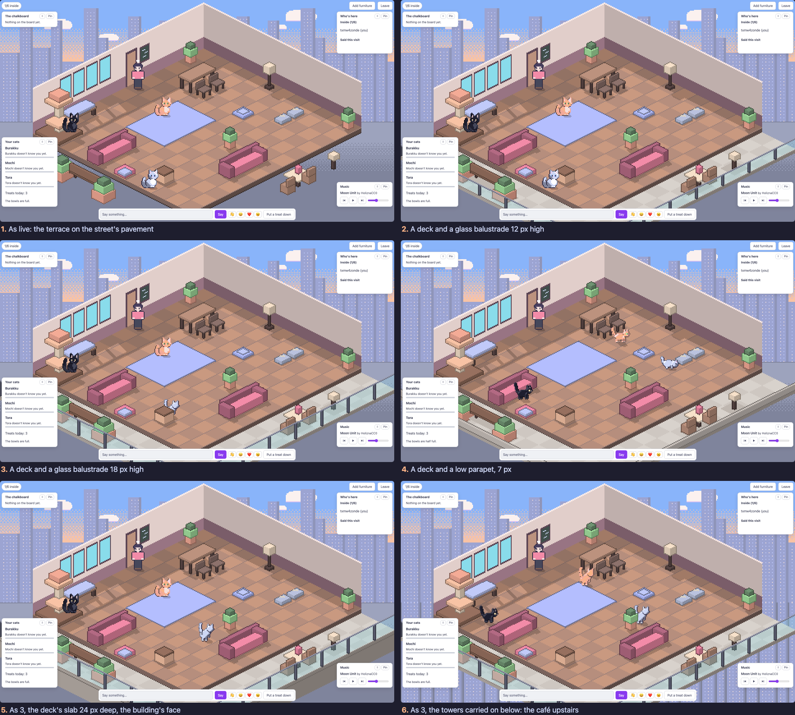

# Slice 18 study: ground under the terrace

On 2026-11-06, having judged slice 16 ("slice 16 looks great"), the user
asked:

> it looks like the stuff on terrace is floating. how can we improve that?
> maybe some ground, or fencing? The cafe feels like it belongs to a
> shopping centre or business building, so maybe some balcony tiles with
> glass fence? what do you think

This note is the study behind [slice 18's spec](../slices/18-a-balcony-under-the-terrace.md),
which is proposed. The screens are in [screens/slice-18-study/](screens/slice-18-study/).
They were shot from a throwaway build of the client, `main` at `4740c3b`
with [spike.patch](screens/slice-18-study/spike.patch) applied: query
parameters for a deck, its balustrade, its rail's height, its slab and
what shows below it. A local café was started with its clock at 10:00 for
the day and 22:00 for the night (the page keeps the café's hour since
slice 17), and shot at 1920×1080 in the light theme by day and the dark by
night, and at 390×844 on the phone by day. The patch isn't the slice's
code, and nothing from it merges.

The same at night: [compare-night.png](screens/slice-18-study/compare-night.png).
The front corner, close, by day and night:
[compare-corner.png](screens/slice-18-study/compare-corner.png). The phone:
[compare-phone.png](screens/slice-18-study/compare-phone.png).

## 1. Why the terrace floats

The terrace's things are drawn in the room's perspective: each stands on
a tile spot past the floor's edge, its blocks in the isometric angle. What
they stand on isn't. The street behind the room is a flat backdrop in
screen space: sky, towers, then a band of kerb and pavement that runs
level across the screen below the skyline (`streetSlot` in
`client/src/street.ts`). The bench, the table and the lantern have no
ground under them in their own perspective, so nothing says where they
touch down. The eye reads them as hanging in front of the backdrop
(screen 1).

The cure is ground in the room's perspective: a surface drawn on the same
grid as the floor, so each thing stands on a tile of it.

## 2. A balcony deck

Screens 2 to 6 put a deck round the café's two front edges: an L of
paving, 2.6 tiles out from the floor's left edge and from its front, at
the foot of the floor's slab (the floor stands 6 px proud of it, as the
diorama's slab already shows). Its tiles are a light stone, two tones in
a check, darkened by night, with their own thin slab under the deck's
outer edges and a contact shadow under each thing.

- **It grounds the terrace.** With a surface under them the bench, the
  table, the chairs and the lantern stand on something, and the slab's
  edge says where the café's ground ends.
- **It's clear of the room.** The deck is drawn under the floor's own
  slab, so it never covers a floor tile, a wall or a figure's column.
- **It reaches the window's edges.** The room's canvas stops at the
  floor's corners, so the deck is drawn on the street's canvas too (as
  slice 16's street is), lined up to the pixel. A deck drawn only on the
  room's canvas was cut off sharp at its edge in the first shots.

## 3. Glass, a parapet, or nothing at the edge

- **Glass, 12 px** (screen 2): posts every two tiles, a handrail, and
  panes the deck shows through. It reads as a rail, but low: at 12 px it
  comes up to a chair's back.
- **Glass, 18 px** (screen 3): half a person's height (people are 32 px),
  as a balcony's rail is to a person. It reads as a balcony at once, and
  the deck and the things on it show through the glass. The user's own
  words were "balcony tiles with glass fence", and this is the strongest
  match.
- **A low parapet, 7 px** (screen 4): a solid kerb of wall. It grounds
  the deck as well as the glass does, but reads as a planter's edge or a
  street's kerb, not a building's balcony; it hides the deck's foot.

By night the glass picks up the dark and the posts and the handrail show
in the window's light (compare-night.png); by day the panes are a pale
blue-green over the stone.

**The glass must stay crisp** (ADR 0019): no shape is filled as a canvas
path, whose edges the canvas anti-aliases. The spike's first panes were
paths; the screens are from panes filled by whole pixels (`fillCrisp`) in
a see-through colour, so every pane's edge is a hard step and only its
inside is see-through, as a hiding cat is see-through on purpose. The
other way is a 50% dither of the glass's colour, all solid pixels, as the
street's warm band and pavement are dithered; at 4× it would show as a
check over the table and chairs behind the glass, so the screens use the
tint.

## 4. Where the café stands: ground level or upstairs

The user said the café "feels like it belongs to a shopping centre or
business building". Two things can say so.

- **A deep slab** (screen 5): the deck's slab 24 px deep, as the
  building's face dropping away under the balcony. At 1920×1080 it hardly
  shows: the deck's front edge is at the window's foot, under the talk
  bar, and the face falls off screen. Not worth proposing.
- **The towers carried on below** (screen 6): past the glass, where the
  pavement was, the towers across the road carry on down, their windows
  and all, as seen from a floor high up. The café is upstairs, on a
  balcony looking across at the other towers. By night their lit windows
  show below the rail as well as above the room, which is the most
  striking of the six. By day it's busier: the towers' windows show
  through the glass under the table.

Upstairs fits "a shopping centre or business building" and a glass
balcony; a glass rail at street level reads as a café's outdoor seating.
Either works with the deck.

## 5. The phone

The deck and the 18-px glass at 390×844 (compare-phone.png): in layout A
(the whole room at 1×) the rail is a thin bright line round the floor's
two front edges, and the deck reads as a balcony even that small. In
layout B (3×, panned) the deck and glass show at the bottom as you walk to
the front; nothing in the phone's layouts needs to change.

## 6. What it doesn't touch

The deck, its rail and what's below are scenery, as the terrace is: off
the café's grid, taking no click, not in the server's world. Nothing
reaches the server. The terrace's things keep their spots in
`content/street.toml`; the deck's width, the rail's kind and height, and
what shows below would join them there, so the look is changed in
content, not code.
