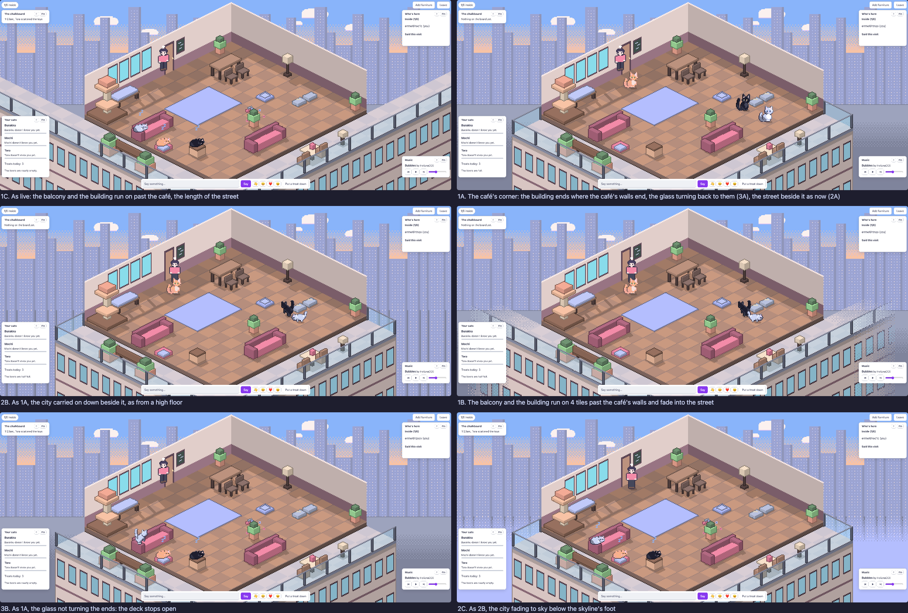

# Slice 19 study: where the balcony ends

On 2026-11-08, judging slice 18 on a wide window by night, the user sent
a screenshot of the balcony running on past the street wall's end, and
wrote:

> still some issue: it looks like the balcony is extending to the whole
> building, but it should just show the cafe corner, like we don't show
> other part of the building. how do we make the infinite balcony and
> building more make sense? maybe give the building a fixed size? or let
> it fade? or something else? help me on this

This note is the study behind [slice 19's spec](../slices/19-the-balcony-ends-with-the-cafe.md),
which is proposed. The screens are in [screens/slice-19-study/](screens/slice-19-study/).
They come from a throwaway build of the client, `main` at `1d7d7b0` with
[spike.patch](screens/slice-19-study/spike.patch) applied. The patch adds
query parameters for how the balcony ends (`ends=run|corner|fade`), for
whether the glass turns the ends (`returns=0`), and for what shows below
the skyline's foot (`below=towers|haze`, slice 18's round-1 code brought
back). The café ran locally and was shot at 2560×1080, a wide window
where the ends show most, at 1920×1080 and on a phone at 390×844, by day
in the light theme and by night in the dark. Each visit's welcome was
told the hour, since the page keeps the café's hour (slice 17). Nothing
from the patch merges.

The same by night: [compare-night.png](screens/slice-19-study/compare-night.png).
Both ends close, at 1×: [compare-ends.png](screens/slice-19-study/compare-ends.png).
The phone: [compare-phone.png](screens/slice-19-study/compare-phone.png).
A tall desktop window: [compare-tall.png](screens/slice-19-study/compare-tall.png).

## 1. Why the run-on balcony looks wrong

Slice 18 ran the balcony and the building on past both ends of the room
to the window's edges. That was the agent's own call, not something the
user approved ([plan.md](plan.md), row 18). It was made because the
study's balcony, stopped at the room canvas's edge, ended in a cut edge
with the dark street beside it.

But the room is a diorama (design.md, "The room is a diorama on its
street"). Its two walls are cut away at their tops, and the floor ends
at its corners. Nothing of the building past the café's walls is shown:
not the corridor behind the street wall, not the next unit along. The
run-on balcony is the one thing that breaks this. It shows the building
going on, so the café reads as one unit on a long gallery, and the eye
then asks why the floor and walls stop where they do. In the user's
screenshot, by night, the balcony runs back past the street wall's end
along the skyline. It looks like a separate walkway the café happens to
sit on.

So the cure is to treat the building the way the walls are treated: show
only the café's corner of it.

## 2. Where the balcony ends (question 1)

- **A. The café's corner, a fixed size** (the user's "give the building a
  fixed size"). The deck, the glass and the building end where the
  café's walls end: the left arm at the street wall's line (y = 1), the
  front arm at the plain wall's line (x = width). The building's wall
  under the deck ends at the same two lines, with a dark edge down each.
  The street and the towers show beside it, as they do beside the walls
  above. The café reads at once as the building's corner, cut out the
  way the room is, with no stray gallery. It looks the same at any
  window size, and it shows less, not more: past a wall's end the
  backdrop is just the street.
- **B. A fade** (the user's "let it fade"). The balcony and building run
  on 4 tiles past the café's walls, then dither into the street. Each
  thing fades along its own face (the stones where they lie, the glass
  along its line, the wall along its face). In the screens it reads as a
  smear, not as distance: the dither breaks the deck's tiles and the
  glass's rail into speckle, and by night the lit windows dissolve into
  dots (compare-ends.png). Pixel art fades by dithering, and a 4-px
  Bayer step this big is coarse at the room's 4× scale. It also keeps
  the "it goes on" reading: a fade says the building continues, only out
  of view.
- **C. As live**: run on to the window's edges. It reads as the gallery
  the user objects to.

Not shot: **a neighbouring building past each end, set back a tile**.
The spike's first draft drew one but it was dropped before shooting. Its
front would carry the café's line on a tile back, which reads as the
building going on again, the very thing the user asked to remove. (The
café's own building has no end wall to show either. In this camera its
right side faces +x and its back end −y, both away from the viewer, so
where it ends only its corner edge shows.)

**A is the proposal.** It's the user's "fixed size", and the same rule
the room already follows.

## 3. What shows beside the café's corner (question 2)

With A, past each end the backdrop shows what's behind the building.

- **A. The street, as now.** Past the left end the skyline's foot and the
  kerb band show at the street's height, with the café's building
  standing in front of them. By day it's the pale pavement band; by
  night a dark band under the lit towers. At 1920×1080 only a sliver
  shows past each end. At 2560×1080 a wedge shows past each end, and the
  building plainly stands in front of the street and its towers.
- **B. The city carried on down** beside the building, as from a high
  floor: slice 18's round-1 A, but now only beside the building, not
  under the balcony. The towers' windows run on down past the building's
  edges. It says "upstairs" more strongly, and by night it's the more
  striking of the two (compare-night.png). By day the towers' pale
  windows make the backdrop busier beside the glass.
- **C. The city fading to sky** below the skyline's foot: slice 18's
  round-1 C, brought back for comparison. By day the building gets sky
  beside it and floats.

The user turned down the city under the balcony in slice 18's study ("the
city background make it a bit wierd or too 'floaty'"). With the
building now carried down under the deck, the towers show only beside
it, so the floating may be gone. But that's for the user to judge.
**A is the proposal**, the street as now: it changes the least and
never shows sky under anything. B is a fair choice if the user wants the
height to read more.

## 4. The glass at the ends (question 3)

Where the deck ends, its open side faces back toward the café's walls.

- **A. The glass turns the ends**: a short run of glass and handrail from
  the deck's outer corner back to each wall, with a post at the wall. A
  balcony is closed on every side, so this reads as a real one. The
  returns are drawn behind the terrace's things and tint what's behind
  them, as the front glass does (ADR 0019).
- **B. The deck stops open**: the glass ends at the deck's outer corner
  and the deck's end is a bare edge. It reads as unfinished, as if the
  balcony goes on but was cut off.

**A is the proposal.**

## 5. The phone

In layout A (the whole room, 390×844) the room canvas fills the width,
and the ends lie just past the screen's edges. 1A, 1B and 1C look almost
the same there (compare-phone.png). In layout B (the
room at 3×, panned), the pan stops at the room canvas's edges
(`panOffset` clamps to the canvas). The balcony's ends lie just past
those edges (the left arm's back end about 42 room px left of the
canvas, the front arm's end the same distance right of it, from
`toCanvas` with the deck 2.6 tiles out), so a phone in B shows the same
as today. A spike tried to shoot B panned to each end with made-up pointer
events and the pan didn't move, so that's from the code, not a screen.
The slice's own browser checks will shoot it.

## 6. A tall window

At 1280×1440 (compare-tall.png) the room sits in the middle with the
backdrop above and below it. 1C runs the balcony and building across
the whole width under the room. 1A shows the café's corner as a block
under the room, with the street beside it: a diorama on its street, as
the room above already reads.

## 7. What it doesn't touch

It's the backdrop only: no click, no server, no protocol. The balcony's
reach stops depending on the window's size. The cost should go down: the
building and the deck are drawn over a fixed few tiles, not the window's
width (the slice measures it as slice 18 did). Slice 18's run-on machinery (`REACH_STEP`, the reach computed
from the span's corners) goes. With it goes the way a narrow span
could draw differently from a wide one, found while answering slice 18's
review (its finding 7).
