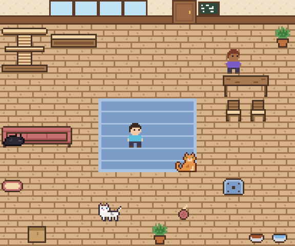
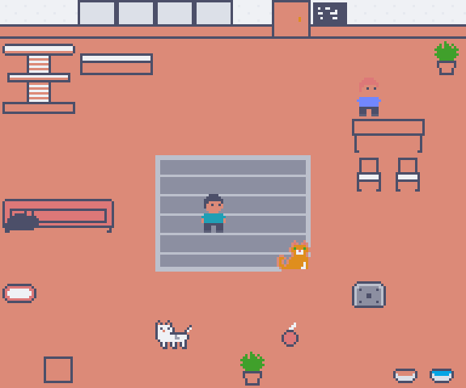
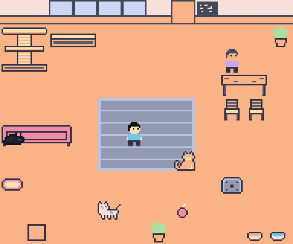
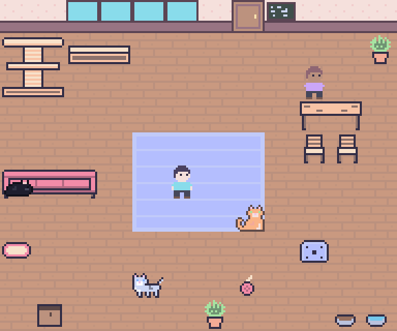
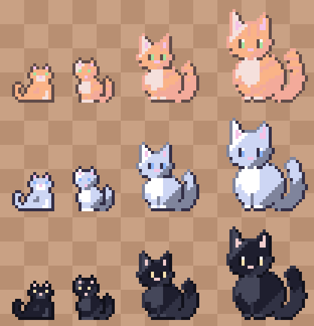
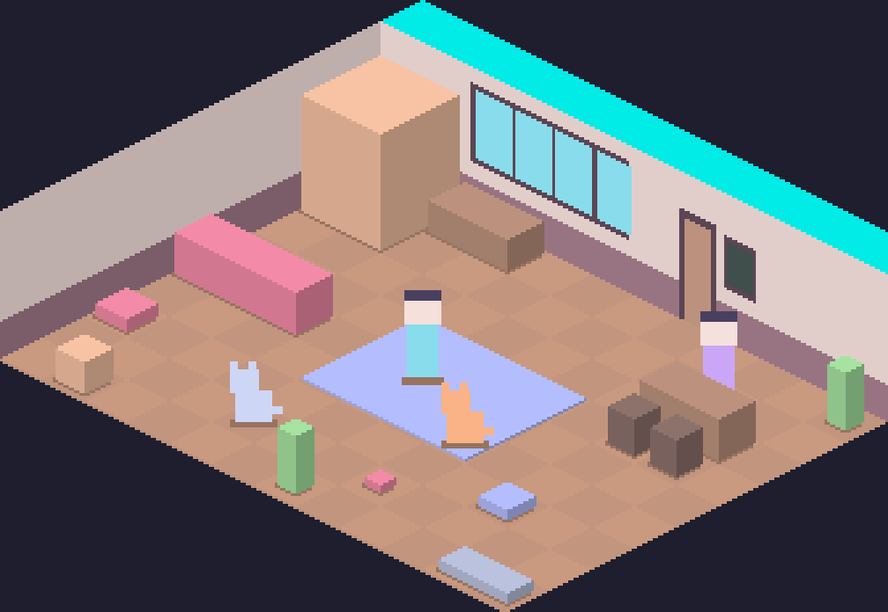
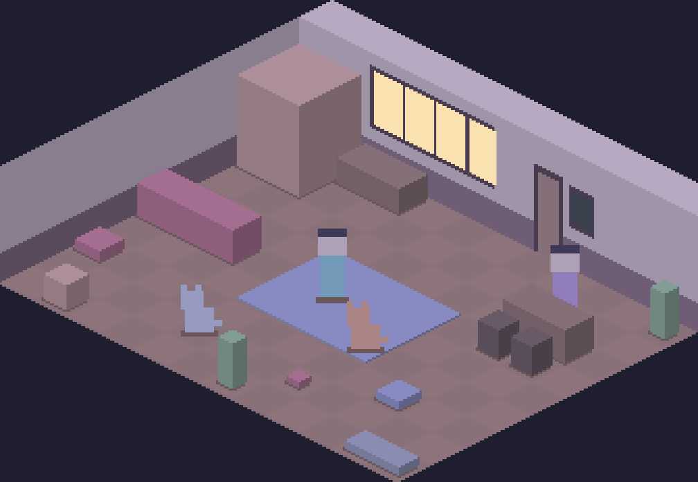

# Visual direction: Catppuccin, pixel density and an angled camera

**Status:** decided 2026-10-21. The user took the suggestion below on every
count: all three changes, layout B as the phone's default, sprites drawn by
the agent, and the page in Latte and Mocha. That is
[ADR 0017](../adr/0017-draw-the-cafe-isometric-in-catppuccin-led-colours.md),
built as slices [09](../slices/09-the-room-seen-at-an-angle.md),
[10](../slices/10-catppuccin-by-day-and-by-night.md) and
[11](../slices/11-cats-you-can-tell-apart.md), which replace slice 05. The
judgement, asked 2026-10-17 18:05 AEDT, stays below as it was.

The user asked for a judgement on three things: whether
[Catppuccin](https://catppuccin.com/) colours can be used, how dense the pixel
art should be, and whether the café should be seen from an angled camera like
Neko Atsume's yard or Hades' rooms. The look now is the 16-px top-down room
in `docs/notes/screens/sitting.png`.

Every picture below was rendered from `content/` by the throwaway scripts in
[screens/visual-direction/scripts/](screens/visual-direction/scripts/), so it
can be made again. None of them is art: they test colours, sizes and fit.

## Catppuccin: yes, as the source of the colours, not as a strict palette

**The case for it.** The café is called Catppuccino and the README says the
name comes from Catppuccin, so its colours give the name a meaning a visitor
can see. Its licence is MIT. It has four flavours of 26 colours: Latte is
light, Frappé and Macchiato are in between, and Mocha is dark.

**What goes wrong if it's used strictly.** Catppuccin has no brown. Its
oranges are peach (Mocha `#fab387`) and a saturated peach (Latte `#fe640b`),
and its neutrals are blue-grey. Snapping every current colour to the nearest
Catppuccin colour:

| Now | Snapped to Latte | Snapped to Mocha |
| --- | --- | --- |
|  |  |  |

The wooden floor turns flat salmon or flat peach. Its boards vanish, because
three close browns collapse into one colour. The box and the cat tower blur
into the floor, and the wood loses its warmth. A café made only of
Catppuccin's 26 colours would look like a theme applied to a game, not a
room.

**What works: Catppuccin-led.** Its hues are the anchors: Mocha's darks for
outlines and shadows; its pastels for cloth, cats, plants and the people's
shirts; and the browns it lacks mixed from peach and rosewater toward its
own surfaces, so they sit in the same family:

This keeps the wood and gets the softer, cooler, slightly lilac cast that
makes Catppuccin recognisable. Even so, it still looks fairly ordinary. That
is the main finding: **most of the "normal" look comes from the drawing, not
the colours.** The room is flat, lit evenly, and seen square-on, with a busy
floor competing with everything on it. Quieting the floor did more here than
the recolour did. A new palette alone would not make the café stand out.

Which flavour to take hues from matters. Latte's accents are saturated
mid-tones, made for dark text on a light page. Against wood they go loud,
which is the salmon room above. Mocha's accents are pastels, made for a dark
page, and they are what sits well on warm wood in daylight. So the study
above takes its accents from Mocha.

**The idea worth having: a day palette and a night palette.** Every sprite
is a grid of palette slots, recoloured when it's cached. So the room can be
drawn in a day palette and a night palette instead of under today's grey
overlay (`client/src/canberra.ts`, a `#0b1030` wash at 38% after 21:00). In
the night study (7, below), every colour is pulled toward Mocha's dark base
and lavender, keeping its lightness, and the window glows yellow from the
street. That's lamplight, which a single tint can't give, and the evening
can step between the two. The name's reference becomes the café's clock.

**Around the room.** The page's own colours (`client/src/style.css`) can
follow: Latte for the light theme and Mocha for the dark one. One catch: on
Latte's base, its accents are too light for text. Latte peach is 2.6:1 and
maroon 3.5:1, both short of the 4.5:1 that normal text needs. So in the
light theme, links and buttons use Latte's mauve (white on it is 5.4:1) or
`text`. Mocha is easy: its text is 11.3:1 and peach is 9.3:1 on its base.

## Density: 32-px tiles, with 24-px cats

**What fits on a tile at each size.** One cat, drawn from the same shapes
and lit the same way (light from the top left, a darker outline below and to
the right), at 16, 24 and 32 px. Today's hand-drawn 16-px cat is on the
left:

- **16 px (now)** is a silhouette. Eyes are one pixel, a tabby's stripes and
  a white chest can't both fit, and the three cats are told apart mostly by
  coat colour. The pose list in slice 05 (nap, eat, play, perch, held, on a
  lap, scratching, knocking something over) is hard to read at this size:
  "on a lap" and "held" are a few pixels apart.
- **24 px** is where a cat gets a face: ears with pink inside, eyes with a
  colour, a chest, a tail with its own shading, stripes. Mochi, Burakku and
  Tora can be told apart by shape and markings, not only by coat. A
  crouched, playing or loafing pose can read.
- **32 px** is nicer still, but a cat that big crowds a person (people would
  need to be about 40 px tall), and every frame of every pose costs nearly
  twice the drawing of 24 px.

**What I suggest.** The floor grid at 32 px a tile (as a 32×16 diamond if
the camera is angled, below). Cats about 24 px, people about 32 to 36 px
tall, furniture at its footprint and as tall as it needs. This is the
density of the Hades-style references that read as "refined": enough pixels
for a highlight and a shadow on every surface, with outlines used only where
shapes overlap. Today's palettes allow 13 to 16 colours per sheet, and each
cat coat gets 6. At 24 px a coat wants about 8 (an outline, two shades, a
base, a light, eyes, pink and white), which the format already allows.

**What it costs.** The content checks hold every sprite at 16 px a tile
(`server/src/content.rs`, `every_sprite_the_client_draws_exists_at_its_size`),
so they change with it. The sprites are typed as text grids today. At 24 to
32 px, with 8 or more poses per cat, that's a lot of typing to get right
blind. It would be better to draw them as PNGs, from a pack or by hand, and
have the loader turn each image into palette slots. That still keeps "cats
change through `content/`, not code". The design already allows a sprite to
be "redrawn later, by hand or from a pack, without touching code".

## The angled camera: yes, as isometric, with a cost on the phone

**Which angle.** The two references are different cameras:

- **Neko Atsume** is a front-on view from above. Floors are drawn as
  receding planes, but the room isn't on a strict grid. It is drawn as one
  picture with spots placed on it.
- **Hades** is a true isometric grid. Every floor tile is a diamond, and
  walls run along two diagonals.

For this café, **isometric (2:1, like Hades)** is the one that fits. The
room is already a grid of tiles where people and cats walk tile to tile,
furniture snaps to tiles, and the keyboard's pointer moves tile by tile. A
2:1 isometric camera keeps that grid exactly. A Neko Atsume picture would
need hand-placed spots that don't follow the grid at all. Here is the room
as it stands (same furniture, same places) under that camera, in blocks:

| Day | Night |
| --- | --- |
|  |  |

Even as plain blocks, it reads as a room you look into, with depth and
corners, and a cat on the rug reads as being on it. That's the thing the
top-down view can't give.

**What stays the same.** The server doesn't change at all. The room stays
12 by 10 tiles, and walks, placement, the door walkway, the cap and every
rule in `docs/design.md` are about tiles, not pixels. The protocol doesn't
change either. The tile grid is the model and the camera is only the
client's way of drawing it.

**What changes in the client.**

- `render.ts`: tiles become diamonds, and drawing order goes by `x + y`
  instead of by row. Furniture that is 2 or 3 tiles long (the sofa, the
  table, the rug) needs care so a cat behind it isn't drawn in front.
- `stage.ts`: `tileToCss` and `cssToTile` become the isometric transform and
  its inverse, picking the diamond under the pointer. Bubbles, menus and the
  ring already place themselves through these two functions, so they follow.
- The keyboard: the arrows should move along the screen's diagonals or
  along the room's axes. That's a choice to make; along the axes, with the
  pointer drawn as a diamond, is the usual one.
- The street wall becomes the back-right wall, and there is a new
  back-left wall. The window, door and chalkboard stay on the street wall.
  The faces in the line show through the window, as now.
- Toppled furniture is drawn rotated today (`drawPiece`), which won't look
  right in isometric. Each piece that can fall needs a lying-down sprite.
- Furniture that faces one way (the sofa, the window seat) may want two
  facings once it can be turned along either axis. Today nothing rotates,
  so this can wait.
- The browser checks tap tiles by `box.width / 12` and `box.height / 10`
  (`spec/browser.test.ts`). They'd need a helper that finds a tile's
  screen position. The test page could expose `tileToCss` for that.

**The real cost: the phone.** At the suggested density, the isometric room
is 336 by 232 px at 1× (the study above). The current room is 192 by 160.

| Room | 1920×1080 desktop | 390×844 phone, layout A |
| --- | --- | --- |
| Now (192×160) | 5× | 2× (384 px wide) |
| Isometric, 32-px tiles (336×232) | 3× (1008×696) | 1× (336 px wide) |

On the desktop it's fine: the room is a little bigger on screen than now
and its pixels are a little coarser. On the phone, layout A drops to 1×,
which is too small: a 24-px cat on a 390-px screen. There are three ways
round it, and this is the user's call:

1. **Make layout B the phone's default.** It already shows the room at 3×,
   panned to follow you, with actions in a ring. With the angled room, B is
   the better phone layout anyway, and A stays as the switch.
2. **Let layout A scale by a fraction on phones only** (1.15× here). Pixels
   go slightly uneven, which "crisp, whole-number scale" in
   `docs/design.md` rules out today.
3. **Keep the room 16-px dense** (a 16×8 diamond): it fits A at 2×, but at
   that size an angled room is a lot of detail in very few pixels, and the
   gain over today is smaller.

I'd take option 1.

## What I suggest, together

1. **Catppuccin-led colours**: Mocha's pastels on warm wood by day, mixed
   from Catppuccin's peach and rosewater; the room pulled toward Mocha's
   dark at night, with the window lit; Latte for the light page and Mocha
   for the dark page. The day-to-night change replaces the grey overlay.
2. **An isometric camera** on the same 12×10 grid, with the server and
   protocol unchanged.
3. **32-px tiles, 24-px cats, 32 to 36-px people**, drawn as PNGs in
   `content/sprites/` and turned into palette slots by the loader.
4. **Layout B as the phone's default.**

Order matters. The camera decides every sprite's shape, so it comes first,
then the palette, then the art. Redrawing 16-px top-down sprites now (slice
05 as written) would be thrown away by any of these changes.

**Scope, honestly.** This is the biggest client change since phase 1: a new
renderer and picking, a new sprite pipeline, and all the art again. The art
is the long part. It probably wants splitting into slices: the camera with
placeholder blocks like the studies above, held by the browser checks; then
the palette with day and night; then the art, cat by cat. Each can ship on
its own and leave the café working. Crit 10 is on Wed 21 October (13:30) and
is about logging, not looks, so none of this needs to land before it. The
final submission is Mon 9 November.

## Left for the user

- Which of the three changes to take (each stands alone, but the camera and
  density go together).
- If the camera is angled: which phone layout becomes the default.
- Whether to draw the sprites by hand, from a pack (whose licence must
  allow it and be credited in the README), or by an agent from PNG
  references.
- Whether the page itself follows Catppuccin, or only the room.
